<div align="center">


# FamFlix

**A shared watchlist for families and friends.**<br>
Keep one list of what to watch, log who watched what, and settle "what shall we watch tonight?" with a movie night everybody votes in.

[**Open the app**](https://famflix.andreicovaciu.dev) · [Features](docs/FEATURES.md) · [Architecture](#architecture) · [Key flows](#key-flows) · [Getting started](#getting-started) · [Deployment](#deployment)

[](https://github.com/covaciuandrei/famflix/actions/workflows/azure-static-web-apps.yml)


</div>

## Overview

FamFlix ends the "what shall we watch?" discussion. Everyone has a private **My list**, every family (a household,
a group of friends) has a shared list, and when nobody can decide a **movie night** puts the same stack of
suggestions in front of everyone: swipe, watch the leaderboard fill up, pick the winner.

It is built to be run for real: Google sign-in, a database that enforces its own security rules, more than 1,600
database checks and 40+ browser scenarios on every push, and a free-tier deployment on Azure.

## Features

| Feature | What you get |
| --- | --- |
| **Family and personal lists** | A private *My list* plus a shared list per family, joined with an invite code that expires. Filter by type, decade and category. |
| **Movie night** | Pick a mood and everyone swipes the same stack (the family's To watch plus TMDB suggestions). A leaderboard decides. Guests can vote from a link, with no account. A night can be edited (who watched, and when) or deleted afterwards. |
| **Plan ahead** | Schedule a night, collect Going / Maybe / Can't answers and get reminders in the app. |
| **Watched together** | Log who was there. Everyone confirms their own score, and the title lands on each person's My list. |
| **Series, episode by episode** | Tick episodes or whole seasons, score each one, see Watching, Caught up or Completed. |
| **Watch again** | Put a title back on To watch, or log another viewing. The history is kept. |
| **Discover** | Swipe through suggestions on your own. What you like goes on My list at once. |
| **Stats** | A family's year in numbers, and a private *Your year*. |
| **Your data** | Download everything FamFlix has about you (JSON or CSV), or delete your account. |
| **Made for phones** | Installable, bottom navigation, light and dark themes. |

Every feature is described in the [feature guide](docs/FEATURES.md).

## Architecture

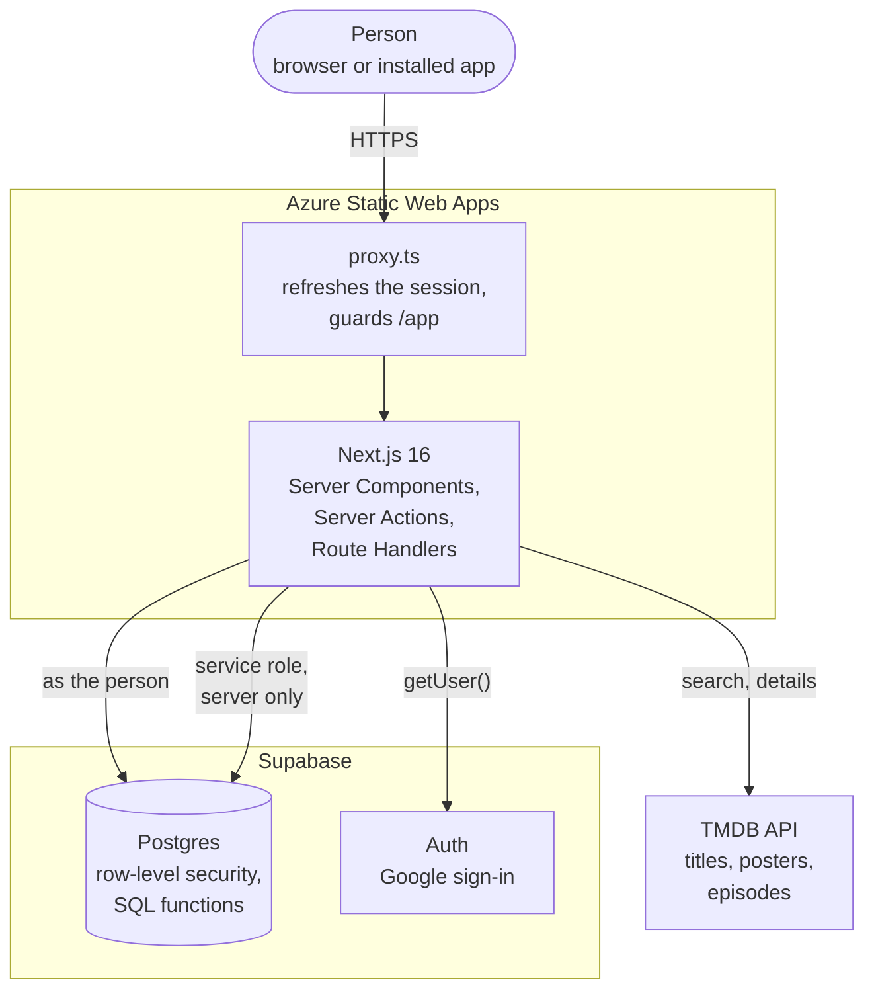

- **The server is the only database client.** The browser never holds a database connection: pages, Server Actions
  and Route Handlers run on the server, acting as the signed-in person.
- **The rules live in Postgres.** Membership, scoring, limits and state changes are enforced by row-level security
  and SQL functions, so they hold whichever code path asks. The app validates only to give friendly messages.
- **A thin service-role escape hatch.** One server-only client
  ([`admin.ts`](src/lib/supabase/admin.ts)) does what a signed-in person must not: save the shared movie info, count
  rate limits, speak for guests and delete an account.
- **Polling, not websockets.** A movie night room polls a light state endpoint every 6 seconds (the menu dot every
  30), so hosting stays simple and fits the free plan.
- **Logic stays pure.** Stats, series progress, stack composition and reminder windows are dependency-free modules
  in [`src/lib`](src/lib), tested without a browser or a database.

### How a request is secured

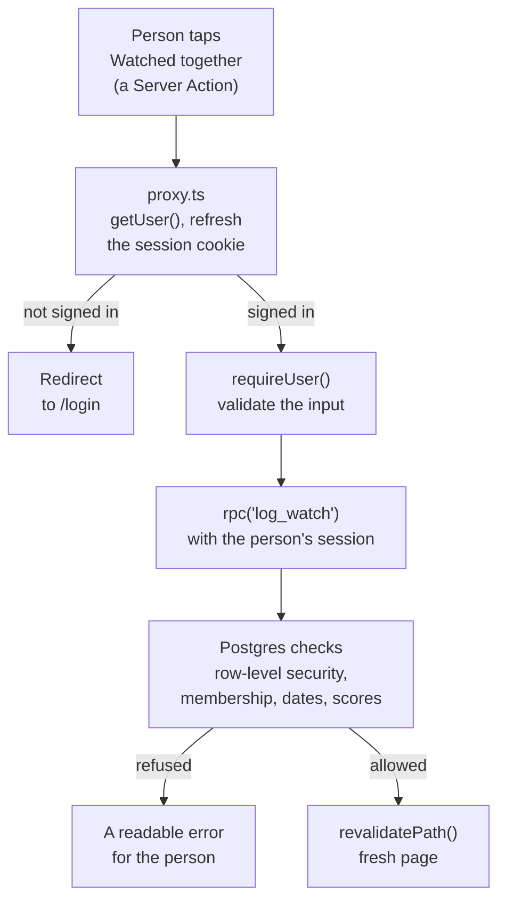

### Signing in

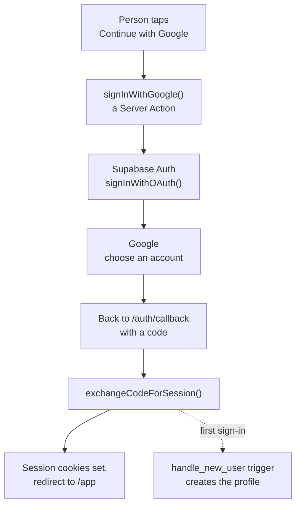

## Key flows

### Movie night

Any member starts a night and picks a mood. The server builds one stack (the family's To watch movies plus TMDB
suggestions), the database creates the night, and everyone swipes the same cards. Results appear as people finish.

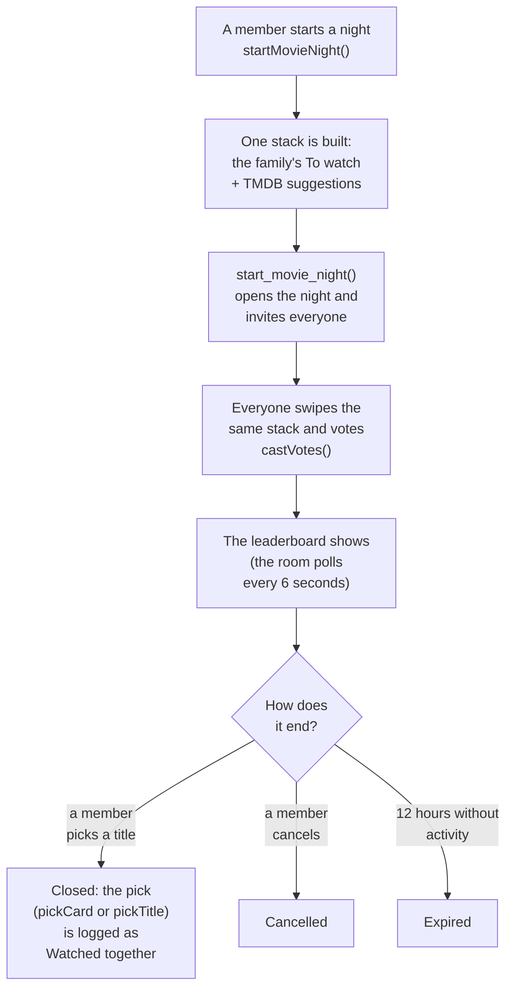

A vote is worth nope −1, yes +1, love +2 or seen it 0. Each person sees the leaderboard once they have finished the
stack, or everyone does as soon as any member reveals the results.

### Guests: voting without an account

Any member can share a link to a night. The guest gives a name and votes on the same cards. The server speaks for
them with functions that only it may run, and they can reach nothing else.

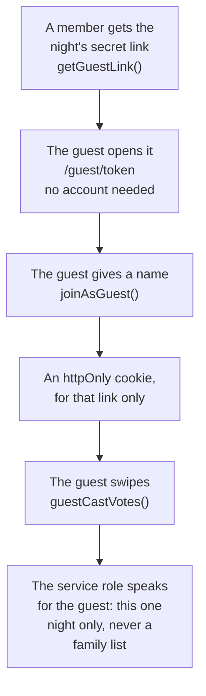

### Plan a movie night

Not tonight? A plan has a day, a time, an optional note and a mood. Members answer Going, Maybe or Can't, and FamFlix
reminds the family inside the app: there is no e-mail and no calendar file.

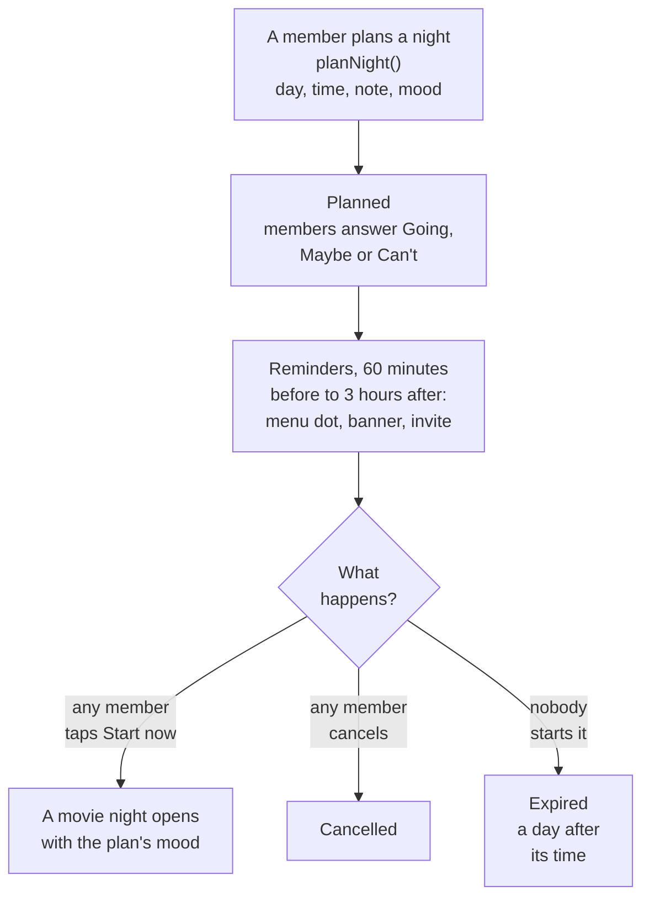

### Watched together

One log updates the family list, every viewer's My list and their rating requests, and anyone can still say "I wasn't
there".

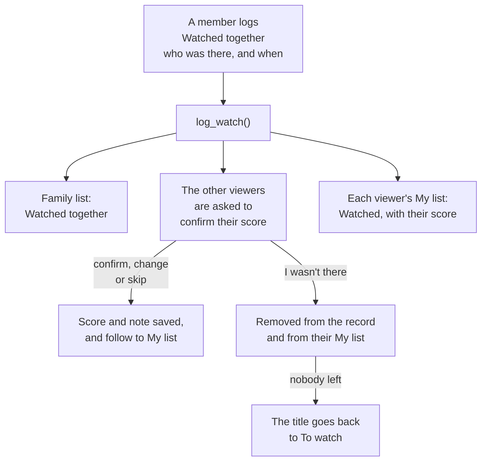

### Series, episode by episode

A series stays one title; its progress is worked out from the episodes you tick and what TMDB says has aired.

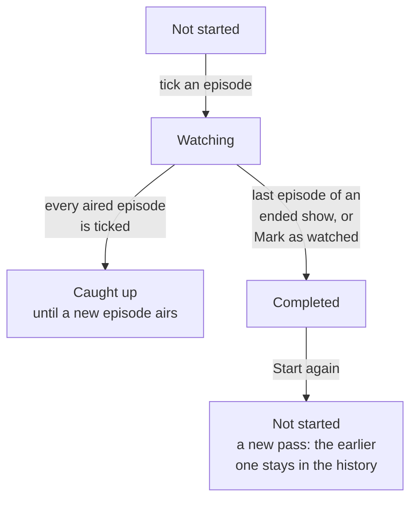

### Code map

| Flow | App code | Database ([`db_init.sql`](supabase/db_init.sql)) |
| --- | --- | --- |
| Sign-in | [`login/actions.ts`](src/app/login/actions.ts), [`auth/callback`](src/app/auth/callback/route.ts), [`proxy.ts`](src/proxy.ts) | `handle_new_user` |
| Lists, scores, reactions | [`app/actions.ts`](src/app/app/actions.ts), [`lib/data.ts`](src/lib/data.ts) | `ratings_follow_family`, `react_to_score` |
| Watched together, watch again | [`app/actions.ts`](src/app/app/actions.ts), [`lib/rewatch.ts`](src/lib/rewatch.ts) | `log_watch`, `watched_again`, `watch_again`, `add_to_my_list_watched` |
| Series by episode | [`series-actions.ts`](src/app/app/media/series-actions.ts), [`lib/series.ts`](src/lib/series.ts) | `mark_episodes`, `my_series_progress`, `watch_series_again` |
| Movie night | [`movie-night/actions.ts`](src/app/app/movie-night/actions.ts), [`lib/deck.ts`](src/lib/deck.ts), [`api/movie-night`](src/app/api/movie-night) | `start_movie_night`, `cast_movie_night_votes`, `movie_night_state`, `pick_movie_night_card` |
| Guests | [`lib/guest.ts`](src/lib/guest.ts), [`guest/`](src/app/guest) | `guest_join`, `guest_cast_votes`, `guest_movie_night_state` |
| Plans and reminders | [`lib/movie-night-plans.ts`](src/lib/movie-night-plans.ts), [`components/movie-night`](src/components/movie-night) | `plan_movie_night`, `rsvp_movie_night_plan`, `due_movie_night_plans` |
| Stats | [`lib/stats.ts`](src/lib/stats.ts), [`lib/stats-data.ts`](src/lib/stats-data.ts), [`components/stats`](src/components/stats) | `my_episode_counts` |
| Download and delete my data | [`api/account/export`](src/app/api/account/export/route.ts), [`app/actions.ts`](src/app/app/actions.ts) | `export_my_data`, `before_profile_delete` |

## Data model

`profiles` are the people (one per sign-in); `group_members` joins them to families. A title's shared info lives once in
`media`; `list_items` puts it on My list (no group) or on a family's list. All 25 tables have row-level security on;
the diagrams show the core of them (reactions, the watch history, the activity feed and the rate limits are left out),
and an arrow reads as "has many".

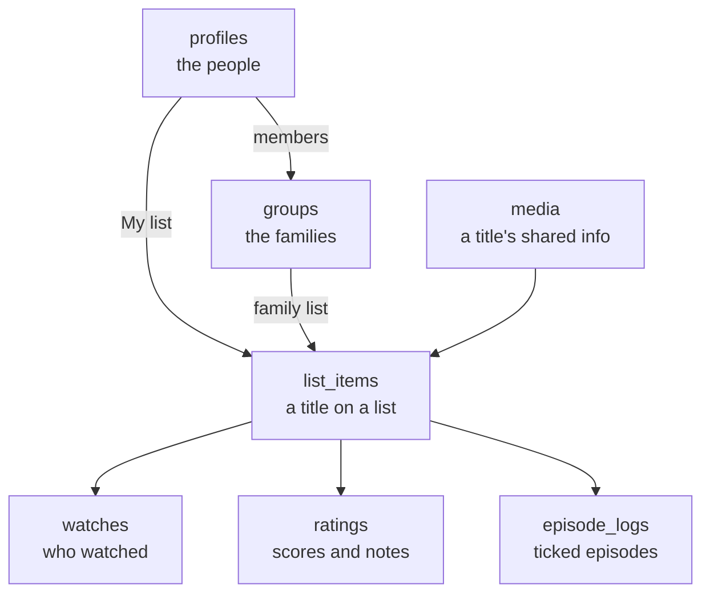

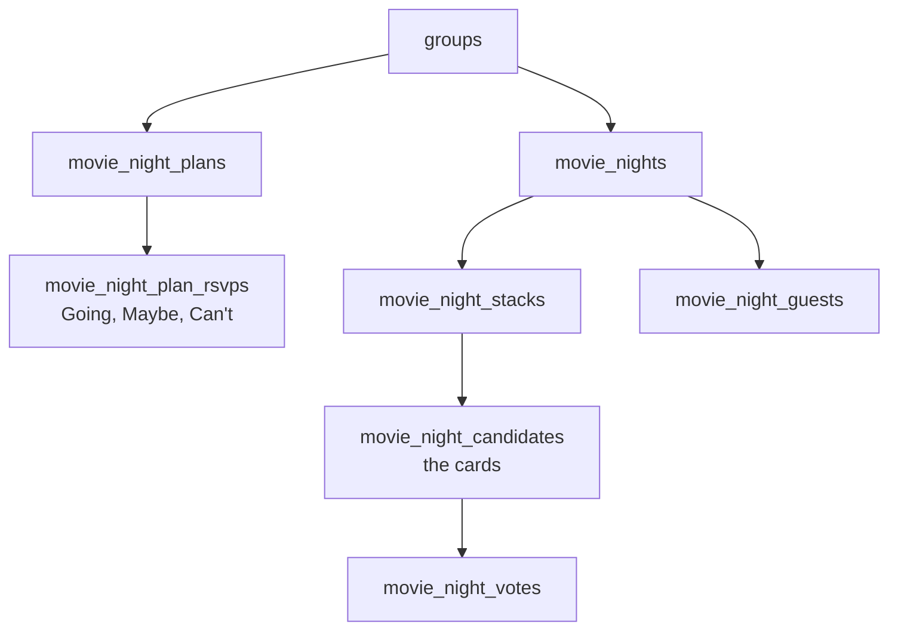

## Security

| Layer | What it does |
| --- | --- |
| Sign-in | Google only; e-mail and password sign-up is switched off in Supabase. [`proxy.ts`](src/proxy.ts) refreshes the session on every request and keeps signed-out visitors out of `/app`. |
| Row-level security | On for every table. My list is readable only by its owner, a family's data only by its members. |
| Database functions | Anything beyond "may I read or write this row" (log a watch, start a night, vote, pick, plan, export) is a SQL function that re-checks who is asking, the dates, the scores and the limits. |
| Explicit grants | Supabase no longer hands new tables and functions to the API roles. [`db_init.sql`](supabase/db_init.sql) grants exactly what each role needs, and the database tests run it under the older and the newer defaults, with an inventory that fails when a table or function is left out. |
| Guests | A guest has no account and no direct access: the server speaks for them through functions only the service role may run. Their link is a secret (`no-referrer`, `noindex`), limited to one night, and stops working when the night ends. |
| Secrets | The service-role key and the TMDB token are server-only (`import "server-only"`), never in a `NEXT_PUBLIC_` variable. |
| HTTP hardening | `Content-Security-Policy` (`frame-ancestors 'none'`, `object-src 'none'`), `X-Frame-Options: DENY`, `nosniff`, a strict `Referrer-Policy` and `Permissions-Policy`, no `X-Powered-By`. Posters load straight from TMDB, so the server's image optimiser stays off. |
| Your data | **Settings → Account** downloads everything FamFlix keeps about you, or deletes your account and data. |

Per-person limits, kept in the database so every server instance shares them:

| Action | Limit |
| --- | --- |
| Add a title, search | 30 and 60 a minute |
| Open a series' seasons, tick episodes | 120 and 180 a minute |
| Open a title's page, open a Discover stack | 120 a minute, 40 an hour |
| Try invite codes, create families | 10 per 10 minutes, 10 an hour |
| Start a family movie night, build another stack | 6 and 10 an hour |
| Plan a night, answer a plan | 10 and 60 an hour |
| Edit a movie night, delete one | 60 and 30 an hour |
| Download your data | 5 an hour |

Names and notes are at most 250 characters, and each family's feed keeps its latest 500 events.

## Tech stack

| Part | Technology |
| --- | --- |
| UI | [React 19](https://react.dev), server and client components |
| Framework | [Next.js 16](https://nextjs.org): App Router, Server Actions, Route Handlers |
| Language | TypeScript 5 |
| Styling | [Tailwind CSS v4](https://tailwindcss.com), [Lucide](https://lucide.dev) icons |
| Database and sign-in | [Supabase](https://supabase.com): Postgres with row-level security, Auth (Google) |
| Movie data | [TMDB API](https://developer.themoviedb.org) |
| Tests | [Playwright](https://playwright.dev) for the browser and the unit tests, plain SQL for the database |
| Hosting and delivery | Azure Static Web Apps, GitHub Actions, Bicep ([`infra/`](infra)) |

## Getting started

You need Node.js 20 or newer, a free [Supabase](https://supabase.com) project, and a free
[TMDB](https://www.themoviedb.org) account with its **API Read Access Token** (the long one, starting with `eyJ`).

### 1. Install and configure

```bash
git clone https://github.com/covaciuandrei/famflix.git
cd famflix
npm install
cp .env.local.example .env.local
```

Fill in `.env.local`:

| Variable | Where to find it |
| --- | --- |
| `NEXT_PUBLIC_SUPABASE_URL` | Supabase → Project Settings → API → Project URL |
| `NEXT_PUBLIC_SUPABASE_ANON_KEY` | Supabase → Project Settings → API → `anon` public key |
| `SUPABASE_SERVICE_ROLE_KEY` | Supabase → Project Settings → API Keys → `service_role` |
| `TMDB_ACCESS_TOKEN` | TMDB → Settings → API → **API Read Access Token** |

> [!WARNING]
> `SUPABASE_SERVICE_ROLE_KEY` can do anything in your database. It stays on the server: it lets the app save movie
> info (which signed-in users can't write themselves) and speak for movie night guests (see
> [`src/lib/guest.ts`](src/lib/guest.ts)). Never put it in a `NEXT_PUBLIC_` variable and never commit it.

### 2. Create the database

In the Supabase dashboard open **SQL Editor**, paste the contents of [`supabase/db_init.sql`](supabase/db_init.sql)
and click Run, once, on an empty database. It creates all tables, security policies and functions, and grants each
Supabase role exactly the access it needs. That last part matters: since 30 May 2026 new Supabase projects (and from
30 October 2026 every project) no longer hand new tables and functions to the API automatically, and the script
doesn't count on it.

To start over on a project that already has FamFlix in it, run this first, then `db_init.sql`.
**It deletes every family, title and user: only do it before you have real data.**

```sql
drop schema public cascade;
create schema public;
delete from auth.users;
```

Whatever you add to the database later, with a new table or function, needs its own `grant` statements too (see the
end of `db_init.sql`), or the API answers "permission denied".

### 3. Enable authentication

FamFlix signs people in with Google only. In Supabase → **Authentication → Sign In / Providers**:

- **Google**: enable it and add your Google OAuth client ID and secret. In Google Cloud, the OAuth client's authorized
  redirect URI is `https://<your-project>.supabase.co/auth/v1/callback`.
- **Email**: turn it off, so nobody can sign up with a password through the API either.

Under **Authentication → URL Configuration**, set the Site URL and add each address the app runs on, followed by
`/auth/callback`, to the Redirect URLs (for example `http://localhost:3000/auth/callback`).

### 4. Run

```bash
npm run dev
```

Open <http://localhost:3000>, continue with Google, then create a family or join one with an invite code.

| Command | What it does |
| --- | --- |
| `npm run dev` | Development server on port 3000 |
| `npm run build`, `npm start` | Production build and server |
| `npm run lint` | ESLint |
| `npm run test:unit`, `test:db`, `test:e2e` | The three test suites, below |

## Testing

| Suite | Command | What it covers | Needs |
| --- | --- | --- | --- |
| Unit | `npm run test:unit` | The pure logic in [`unit/`](unit): stacks and moods, genres, series progress, watch-again counting, the CSV download, stats, reminder windows. 200+ tests. | Node.js |
| Database | `npm run test:db` | [`supabase/tests/`](supabase/tests): security rules, who may call which table and function, families, scores, limits, account deletion, that a download has everything of yours and nothing of anyone else's, movie nights, editing and deleting them, guests, plans, stats. 1,600+ checks. | PostgreSQL 17 |
| Browser | `npm run test:e2e` | [`e2e/`](e2e): signing in, lists, watched together, watching again, movie nights from the invite to the pick, changing or deleting a night afterwards, guests joining with a link, plans and reminders, stats, downloading your data, deleting an account. 40+ scenarios, each on a desktop-sized and a phone-sized screen. | Docker |

- The database tests build a throwaway database from `db_init.sql` **twice**: with Supabase's older defaults (new
  tables and functions are handed to the API roles) and its newer ones (nothing is). Both must pass. Install
  PostgreSQL 17, or point `PGHOST` at a server where they may create a database.
- The browser tests run against a local Supabase ([`supabase/config.toml`](supabase/config.toml)) built from
  `db_init.sql` the way a new project is set up, never the live one. `npx supabase stop` shuts it down afterwards.

## Deployment

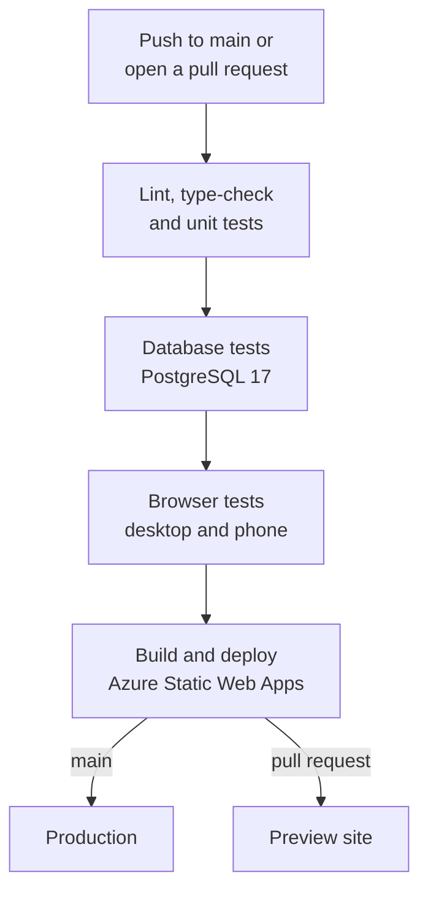

The live site runs on **Azure Static Web Apps** (Free plan).
[`azure-static-web-apps.yml`](.github/workflows/azure-static-web-apps.yml) tests, builds and deploys every push to
`main`, and nothing is deployed unless every suite passes. Pull requests get a preview site, closed with the pull
request.

1. Create a detached Free Static Web App from the Bicep files in [`infra/`](infra), then add these repository
   secrets in GitHub: `AZURE_STATIC_WEB_APPS_API_TOKEN`, `NEXT_PUBLIC_SUPABASE_URL`,
   `NEXT_PUBLIC_SUPABASE_ANON_KEY` and `TMDB_ACCESS_TOKEN`. Configure the same three application variables, plus
   `SUPABASE_SERVICE_ROLE_KEY` (only the running server needs it, not the build), in Azure's runtime settings.
2. In Supabase → URL Configuration, set the Site URL to the production address and add
   `https://<your-domain>/auth/callback` to the Redirect URLs.
3. **The database is deployed separately.** Pushing deploys code, not SQL: run new SQL in the SQL Editor before
   pushing code that needs it, and keep `supabase/db_init.sql` up to date so a fresh database gets everything. If
   the code does get there first, pages degrade instead of breaking ("Planning movie nights isn't set up yet").

The [deployment guide](docs/DEPLOYMENT-GUIDE.md) explains the complete setup for beginners: infrastructure, secrets,
DNS, HTTPS, authentication, limits and troubleshooting.

## Project structure

```text
src/
  app/
    app/              Signed-in area: browse, mine, family, groups, movie-night, media, settings
    api/              Route Handlers: search, series seasons, movie night state, account download
    guest/[token]/    A movie night guest's link, outside the signed-in area, with its own state route and actions
    login/, auth/     Google sign-in and the OAuth callback
  components/         UI: movie-night, stats, series, rewatch, title, discover, guest, ui
  lib/                Data loading, the TMDB client, Supabase clients and the pure logic (series, stats, deck, plans)
  proxy.ts            Refreshes the Supabase session and protects /app (the Next.js 16 replacement for middleware)
supabase/
  db_init.sql         The whole database: tables, security policies, functions, triggers and grants
  tests/              The database tests and their runner
  config.toml         The local Supabase the browser tests use
unit/                 Unit tests of the pure logic
e2e/                  Browser tests
scripts/e2e.sh        Starts the local Supabase, builds the app against it and runs the browser tests
infra/                Bicep for the Azure Static Web App
docs/                 Feature guide and deployment guide
```

## Documentation

- [Feature guide](docs/FEATURES.md): every feature and the rules behind it.
- [Deployment guide](docs/DEPLOYMENT-GUIDE.md): how FamFlix goes from a laptop to the live site.

## Notes

- This product uses the TMDB API but is not endorsed or certified by TMDB.
